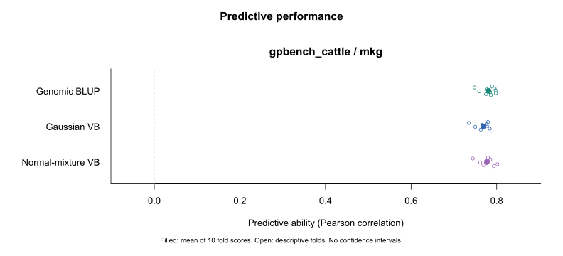
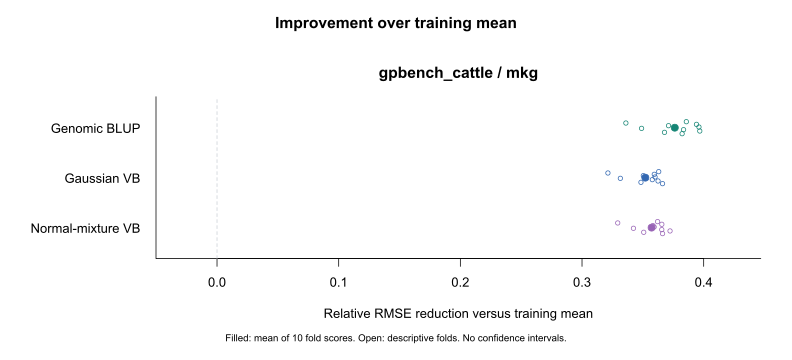
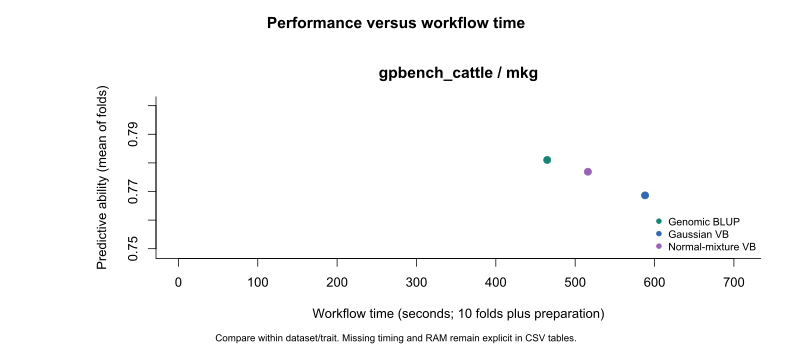
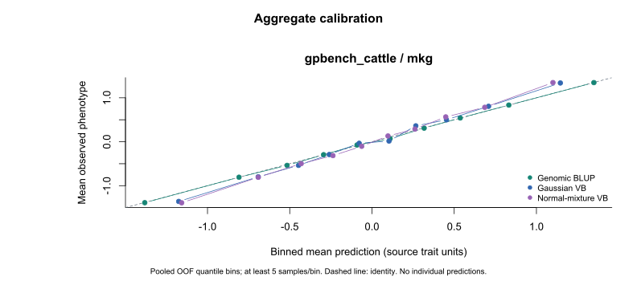

# Cattle: gsuite prediction models

## Scientific question and dataset

Predict supplied phenotypes using all source markers and the published GPBench ten-fold split algorithm. Original IDs, upstream processing and phenotype units remain unverified.

| Dataset | Species | Trait | Individuals Evaluated | Observed Targets | Imputed Targets | Available markers | Markers Used |
| --- | --- | --- | --- | --- | --- | --- | --- |
| gpbench_cattle | Bos taurus | mkg | 5024 | 5024 | 0 | 42551 | 42551 |

[Full dataset catalogue and source definitions](../assets/reports/20261121-gsuite-models/cattle/dataset_catalogue.csv)

## Methods and validation

Shuffled ten-fold KFold, seed 42, scikit-learn 1.6.1 and NumPy 1.26.4. All supplied markers and raw dosage coordinates are retained. Genomic BLUP estimates variances by REML through greml/gsolve, using K=ZZt/p. gbayes Gaussian and sparse normal-mixture VB use fixed working h2=0.5 and training-only phenotype/marker variances; the mixture fixes inclusion probability at 0.1. The native streamed interface projects an intercept without SD scaling. No model is tuned on test outcomes.

To reproduce GPBench, missing phenotypes are mean-imputed before splitting. Two maize DTT targets are imputed; cattle has none. Imputed labels are not genuinely observed phenotypes. The observed-target-only sensitivity summary excludes them from evaluation. This reproduction does not endorse whole-dataset phenotype imputation for a new scientific study.

| Method | Package | Package Version | Native Engines | Tuning | Convergence |
| --- | --- | --- | --- | --- | --- |
| gblup_reml | gsuite | 0.43.0 | greml 0.92.0; gsolve 0.28.0 | No test-fold tuning | Score tolerance 1e-04 ; hybrid EM-AI; requested direct threads 4; returned backend settings in fold CSV; cap 100 |
| gbayes_gaussian | gbayes | 0.1.16 | gbayes native streamed variational prediction | No tuning; training var(y) split h2=0.5; average effect variance=0.5*var(y)/sum(training marker variances); mixture nonzero variance divided by 0.1 | Per-sample negative-ELBO stabilization; tolerance 1e-06 ; sweep cap 100 ; chunk 128; local iterations 20; full refresh 8; one worker; managed 1 GiB; Gram cache 256 MiB |
| gbayes_mixture | gbayes | 0.1.16 | gbayes native streamed variational prediction | No tuning; training var(y) split h2=0.5; average effect variance=0.5*var(y)/sum(training marker variances); mixture nonzero variance divided by 0.1 | Per-sample negative-ELBO stabilization; tolerance 1e-06 ; sweep cap 100 ; chunk 128; local iterations 20; full refresh 8; one worker; managed 1 GiB; Gram cache 256 MiB |

[Full model and method settings](../assets/reports/20261121-gsuite-models/cattle/method_settings.csv)

Fitting calls gsuite::gs_lmm_fit or gbayes::bayes through installed R interfaces to our compiled libraries. The gbayes R bindings are in the gsuite repository; the native core has its own gbayes repository. Exact source commits are pinned below; implementation source and binaries remain private.

| Software | Version | Private Source Commit |
| --- | --- | --- |
| gsuite | 0.43.0 | [19f876e71df0](https://github.com/psoerensen/gsuite/tree/19f876e71df014b996dbd09d0ae01ab3d0709829) |
| greml | 0.92.0 | [c84f83409e7a](https://github.com/psoerensen/greml/tree/c84f83409e7a08eeada20e854c6ff6c81c8ed25f) |
| gsolve | 0.28.0 | [dd405973d6ae](https://github.com/psoerensen/gsolve/tree/dd405973d6aece137fb9d82367502f78c8feef2d) |
| gbayes | 0.1.16 (R package) | [67e8bdf1b617](https://github.com/psoerensen/gbayes/tree/67e8bdf1b617272e65174399889926c92ca11706) |

[Software and source commits](../assets/reports/20261121-gsuite-models/cattle/software_sources.csv)

## Results

Main scores are arithmetic means of ten test-fold metrics, matching GPBench. Predictive R2 uses each test fold mean as its reference. Descriptive fold standard deviations use NumPy ddof=0; no confidence intervals or independent fold replicates are implied. Pooled OOF metrics are separate.

| Dataset | Trait | Method | Predictive ability | RMSE | Predictive R² | Calibration Slope | Fit (s) | Predict (s) | Kernel Seconds | Workflow Seconds | Status |
| --- | --- | --- | --- | --- | --- | --- | --- | --- | --- | --- | --- |
| gpbench_cattle | mkg | gblup_reml | 0.78103 | 0.62353 | 0.60815 | 0.99996 | 453.07 | 0.05 | 11.65 | 464.77 | completed |
| gpbench_cattle | mkg | gbayes_gaussian | 0.76864 | 0.64775 | 0.57736 | 1.15600 | 581.28 | 1.39 | 0.00 | 588.06 | completed |
| gpbench_cattle | mkg | gbayes_mixture | 0.77691 | 0.64269 | 0.58407 | 1.20030 | 509.51 | 1.29 | 0.00 | 516.02 | completed |

[Results CSV](../assets/reports/20261121-gsuite-models/cattle/benchmark_results.csv) · [Fold values](../assets/reports/20261121-gsuite-models/cattle/fold_results.csv) · [Pooled OOF](../assets/reports/20261121-gsuite-models/cattle/pooled_results.csv) · [Observed targets only](../assets/reports/20261121-gsuite-models/cattle/observed_only_metrics.csv)

## Performance and computational cost

<figure class="report-figure"></figure>

[Full-size performance SVG](../assets/reports/20261121-gsuite-models/cattle/performance.svg)

<figure class="report-figure"></figure>

[Full-size improvement SVG](../assets/reports/20261121-gsuite-models/cattle/improvement.svg)

<figure class="report-figure"></figure>

[Full-size runtime SVG](../assets/reports/20261121-gsuite-models/cattle/runtime.svg)

Workflow seconds include method-specific preparation, ten fits and ten predictions. greml/gsolve additionally includes its reusable raw-dosage kernel and fold blocks. gbayes preparation includes training/target matrix extraction; fitting includes training prior calculations, native projection and variational updates. These are single-execution timings; peak RAM is unmeasured. Zero seconds means below timer resolution.

The reviewed greml/gsolve execution is retained; gbayes methods were measured in an additional execution batch on the same hardware and optimized runtime. Run IDs and fitting sessions distinguish the measurements.

R/OpenBLAS and the MKL environment request four threads. The greml component backend returns requested/resolved/support settings of one in this build; gbayes requests and reports one package worker. Returned settings are retained in fold CSVs and do not measure CPU utilization. Variational convergence means negative-ELBO stabilization, not a certificate of a global mixture optimum. Provisional sweep-cap fits remain explicitly labelled.

## Calibration, convergence and solver checks

<figure class="report-figure"></figure>

[Full-size calibration SVG](../assets/reports/20261121-gsuite-models/cattle/calibration.svg) · [Aggregate bins](../assets/reports/20261121-gsuite-models/cattle/calibration_bins.csv)

| Dataset | Method | Fold | Status | Convergence | Warning Count |
| --- | --- | --- | --- | --- | --- |
| gpbench_cattle | gblup_reml | 1 | completed | converged | 0 |
| gpbench_cattle | gblup_reml | 2 | completed | converged | 0 |
| gpbench_cattle | gblup_reml | 3 | completed | converged | 0 |
| gpbench_cattle | gblup_reml | 4 | completed | converged | 0 |
| gpbench_cattle | gblup_reml | 5 | completed | converged | 0 |
| gpbench_cattle | gblup_reml | 6 | completed | converged | 0 |
| gpbench_cattle | gblup_reml | 7 | completed | converged | 0 |
| gpbench_cattle | gblup_reml | 8 | completed | converged | 0 |
| gpbench_cattle | gblup_reml | 9 | completed | converged | 0 |
| gpbench_cattle | gblup_reml | 10 | completed | converged | 0 |
| gpbench_cattle | gbayes_gaussian | 1 | completed | converged | 0 |
| gpbench_cattle | gbayes_mixture | 1 | completed | converged | 0 |
| gpbench_cattle | gbayes_gaussian | 2 | completed | converged | 0 |
| gpbench_cattle | gbayes_mixture | 2 | completed | converged | 0 |
| gpbench_cattle | gbayes_gaussian | 3 | completed | converged | 0 |
| gpbench_cattle | gbayes_mixture | 3 | completed | converged | 0 |
| gpbench_cattle | gbayes_gaussian | 4 | completed | converged | 0 |
| gpbench_cattle | gbayes_mixture | 4 | completed | converged | 0 |
| gpbench_cattle | gbayes_gaussian | 5 | completed | converged | 0 |
| gpbench_cattle | gbayes_mixture | 5 | completed | converged | 0 |
| gpbench_cattle | gbayes_gaussian | 6 | completed | converged | 0 |
| gpbench_cattle | gbayes_mixture | 6 | completed | converged | 0 |
| gpbench_cattle | gbayes_gaussian | 7 | completed | converged | 0 |
| gpbench_cattle | gbayes_mixture | 7 | completed | converged | 0 |
| gpbench_cattle | gbayes_gaussian | 8 | completed | converged | 0 |
| gpbench_cattle | gbayes_mixture | 8 | completed | converged | 0 |
| gpbench_cattle | gbayes_gaussian | 9 | completed | converged | 0 |
| gpbench_cattle | gbayes_mixture | 9 | completed | converged | 0 |
| gpbench_cattle | gbayes_gaussian | 10 | completed | converged | 0 |
| gpbench_cattle | gbayes_mixture | 10 | completed | converged | 0 |

The following fixed-variance gsolve check uses the variance estimates from our greml fit on representative folds: cattle folds 1 and 9 (including the previously problematic fold), maize fold 1. It checks prediction equivalence; its solve time excludes REML and is not another complete-method timing.

| Fold | Status | Max Prediction Difference | Prediction Correlation | Elapsed Seconds | Requested Workers | Stage | Dataset | Trait |
| --- | --- | --- | --- | --- | --- | --- | --- | --- |
| 1 | converged | 4.2842e-10 | 1 | 103.36 | 1 | representative-fold fixed-variance GLS/BLUP; two RHS; REML excluded | gpbench_cattle | mkg |
| 9 | converged | 5.7336e-10 | 1 | 72.19 | 1 | representative-fold fixed-variance GLS/BLUP; two RHS; REML excluded | gpbench_cattle | mkg |

[Solver checks CSV](../assets/reports/20261121-gsuite-models/cattle/solver_checks.csv)

## Earlier attempt and convergence sensitivity

The retained greml baseline uses score tolerance 1e-4. Its earlier attempt at 1e-6 completed nine folds but failed the likelihood-step acceptance check in fold nine. That attempt and its costs remain disclosed separately. The gbayes convergence criterion is different and is specified in the method settings.

| Dataset | Run Id | Method | Fold | Score Tolerance | Status | Convergence | Fit (s) | Message |
| --- | --- | --- | --- | --- | --- | --- | --- | --- |
| gpbench_cattle | 20261121-gsuite | gblup_reml | 9 | 1e-06 | failed | unavailable | 202.22 | greml/gsolve: no component exact likelihood-monotone step was accepted |

[Earlier statuses and costs](../assets/reports/20261121-gsuite-models/cattle/earlier_attempts.csv) · [Prediction sensitivity](../assets/reports/20261121-gsuite-models/cattle/tolerance_comparison.csv)

## Reproduce

Build and activate the pinned environment using environment/README.md in the repository. Set external GPCT_DATA_DIR and GPCT_OUTPUT_DIR; acknowledge positional alignment. Then run scripts/prepare.R CASE, benchmarks/CASE_prediction/run.R, scripts/check_solvers.R RUN_DIRECTORY and scripts/report_prediction.R RUN_DIRECTORY.

[Run metadata](../assets/reports/20261121-gsuite-models/cattle/run_metadata.csv) · [Recipe checksums](../assets/reports/20261121-gsuite-models/cattle/recipe_checksums.csv) · [Reporting session](../assets/reports/20261121-gsuite-models/cattle/report-sessionInfo.txt)

Individual predictions, fold assignments, saved fits, raw diagnostics, private implementation source and binaries stay outside the public repository.

[R packages loaded during fitting](../assets/reports/20261121-gsuite-models/cattle/fit-sessionInfo.txt)
