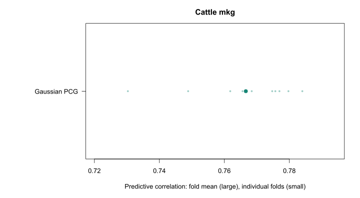
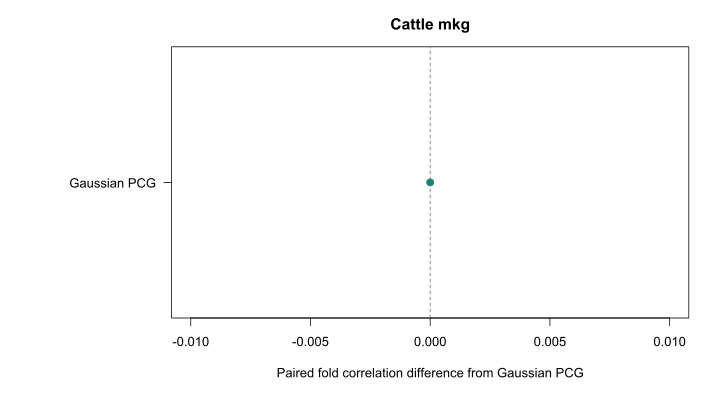
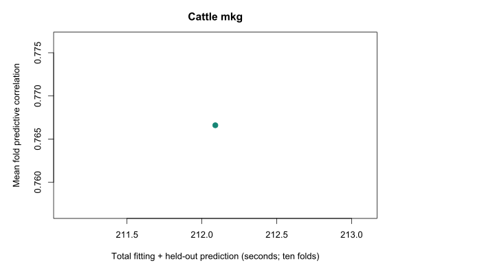
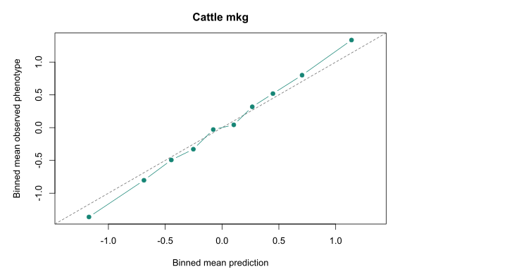

# Cattle / mkg

Predict the supplied mkg phenotype within this GPBench cohort using existing gbayes methods. All fits and held-out predictions receive Glist.

5024 individuals; 42551 available markers; 42373 QC-retained markers. Synthetic BIM/FAM annotations are bookkeeping, not biological maps.

Saved GPBench ten-fold splits, seed 42; one native worker and one BLAS/OpenMP thread. Native method-specific coding is preserved. See the [protocol](../protocol.html) and [settings](../methods.html).

| Method | Correlation | RMSE | Pooled predictive R² | Calibration slope | Fit s | Predict s | Process peak MiB |
| --- | --- | --- | --- | --- | --- | --- | --- |
| Gaussian PCG | 0.767 | 0.650 | 0.577 | 1.160 | 197.6 | 14.5 | 1725 |

Correlation and RMSE in this table are means of ten fold metrics. Predictive R² and calibration slope are calculated from pooled out-of-fold predictions. Fold variation is descriptive; no independent-replicate confidence intervals are claimed.

Shared training-Glist preparation across ten folds: 12.52 seconds. Fitting includes native genotype preparation; prediction is timed separately. Process peak RAM covers package loading, preparation, all folds, saved outputs and prediction; it is not fit-only peak RAM.

[Summary CSV](../assets/reports/gbayes-glist-1t/cattle/benchmark-results.csv) · [Fold metrics](../assets/reports/gbayes-glist-1t/cattle/fold-results.csv) · [Aggregate calibration](../assets/reports/gbayes-glist-1t/cattle/calibration-summary.csv)

## Predictive performance

[](../assets/reports/gbayes-glist-1t/cattle/performance.svg)

## Improvement over Gaussian

[](../assets/reports/gbayes-glist-1t/cattle/improvement.svg)

## Performance and cost

[](../assets/reports/gbayes-glist-1t/cattle/runtime.svg)

## Calibration

[](../assets/reports/gbayes-glist-1t/cattle/calibration.svg)

Mean-imputed evaluation targets: 0 . Observed-target-only pooled correlations are provided in the summary CSV. No individual prediction plots or records are published.

## Diagnostics and reproduction

Warnings across published fits: 0 . Convergence status is retained per fold in the downloadable metrics. Native diagnostics and saved fits remain local.

```powershell
./environment/activate.ps1 -BlasThreads 1
Rscript --vanilla scripts/run_gbayes.R marker_gaussian cattle
```

Replace the method ID with another listed in the [method settings](../methods.html). Individual data and outputs must use the external directories described in the repository. [Back to all results](../results.html).
