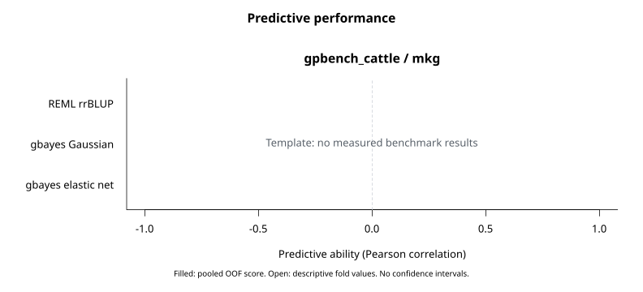
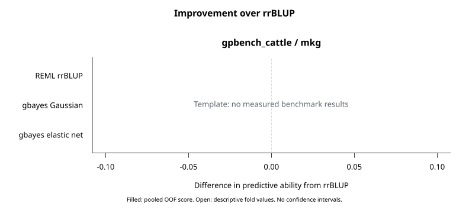
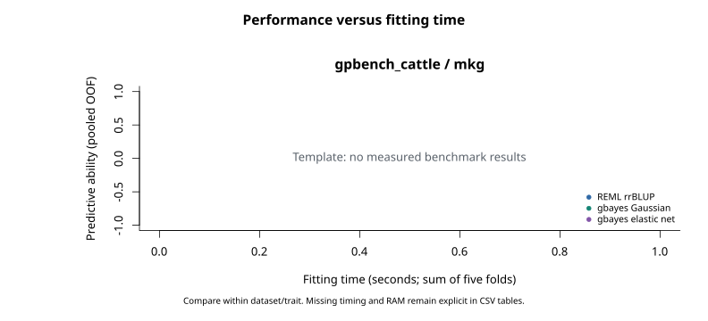
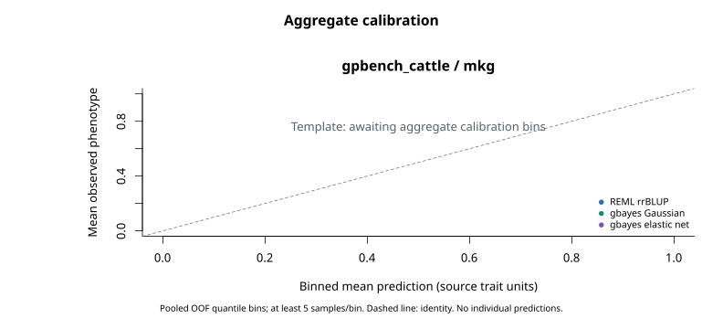

# Cattle prediction: mkg

**Planned report template. No measured benchmark results.**

## Scientific question and dataset

How well do the declared methods predict the supplied trait within this dataset under shared random five-fold validation? Source trait definitions, upstream adjustments and units remain unverified.

Recipe: [gpbench_cattle](https://github.com/psoerensen/gpct/tree/main/benchmarks/cattle_prediction)

| Species | Dataset | Trait | Individuals available | Eligible individuals | Available markers | Planned markers | Markers fitted, min | Markers fitted, max |
| --- | --- | --- | --- | --- | --- | --- | --- | --- |
| Bos taurus | gpbench_cattle | mkg | 5024 | 5024 | 42551 | 512 | not available | not available |

[Dataset catalogue CSV](../assets/reports/templates/cattle/dataset_catalogue.csv)

## Methods and validation design

Single shared five-fold partition, seed 4401. All methods use the same eligible samples and frozen training-only transformations. Fixed pilot settings; no tuning on test folds. REML rrBLUP is the baseline.

| Dataset | Trait | Method | Package | Package Version | Tuning Strategy | Model Settings | Convergence Criteria | Requested Package Threads | Actual Threads | Managed Memory Budget Mib |
| --- | --- | --- | --- | --- | --- | --- | --- | --- | --- | --- |
| gpbench_cattle | mkg | rrblup | rrBLUP | not run | training-only REML variance estimation; no CV tuning | REML ridge; variance ratio fitted on training data; bounds 1e-9 to 1e9 | REML optimizer; no flag exposed | not available | not available | not available |
| gpbench_cattle | mkg | gbayes_gaussian | gbayes | not run | none; fixed predeclared settings | marker_gaussian/pcg; standardized outcome; ve=0.5; prior variance=0.5/p; nit=2000 | native tolerance 1e-08 and iteration cap; inspect diagnostics | 1 | not available | 512 |
| gpbench_cattle | mkg | gbayes_elastic_net | gbayes | not run | none; fixed predeclared settings | elastic_net/coordinate_descent; standardized outcome; lambda=0.1; alpha=0.5; nit=2000 | native tolerance 1e-08 and iteration cap; inspect diagnostics | 1 | not available | 512 |

[Method settings CSV](../assets/reports/templates/cattle/method_settings.csv) · [Run metadata CSV](../assets/reports/templates/cattle/run_metadata.csv)

## Main results

Main metrics are calculated from pooled out-of-fold predictions. Fold means are a separate descriptive summary. NA means not run, not measured or undefined; consult status. Available markers and actually fitted markers are separate.

| Dataset | Trait | Method | Predictive ability | RMSE | Predictive R² | Calibration Intercept | Calibration Slope | Fit (s) | Predict (s) | Method elapsed (s) | Peak RAM (MB) | Ram Status | Status |
| --- | --- | --- | --- | --- | --- | --- | --- | --- | --- | --- | --- | --- | --- |
| gpbench_cattle | mkg | rrblup | not available | not available | not available | not available | not available | not available | not available | not available | not available | not measured | planned |
| gpbench_cattle | mkg | gbayes_gaussian | not available | not available | not available | not available | not available | not available | not available | not available | not available | not measured | planned |
| gpbench_cattle | mkg | gbayes_elastic_net | not available | not available | not available | not available | not available | not available | not available | not available | not available | not measured | planned |

[Download summary CSV](../assets/reports/templates/cattle/benchmark_results.csv) · [Per-fold metrics](../assets/reports/templates/cattle/fold_results.csv) · [Fold means](../assets/reports/templates/cattle/fold_metric_means.csv)

## Performance and computational cost

Filled dots show pooled OOF scores; open dots show descriptive fold values. No confidence intervals are implied. Baseline changes use matched dataset/trait and folds. Raw RMSE is never combined across traits.

<figure class="report-figure"></figure>

[Full-size performance SVG](../assets/reports/templates/cattle/performance.svg)

<figure class="report-figure"></figure>

[Full-size baseline-improvement SVG](../assets/reports/templates/cattle/improvement.svg)

<figure class="report-figure"></figure>

[Full-size performance/runtime SVG](../assets/reports/templates/cattle/runtime.svg)

Fitting and prediction seconds are summed over five folds. Method elapsed includes loading, diagnostics and scoring but excludes shared input/fold preparation and CSV writes. Case elapsed includes all methods and shared work and is not a per-method cost. Peak RAM and actual thread counts are not measured by the pilot runner; they remain NA. gbayes requests one package worker; rrBLUP/BLAS thread control is not exposed.

## Calibration, convergence, warnings and failed fits

Calibration uses pooled OOF quantile bins (up to ten, at least five individuals per published bin) and an identity line. Only aggregate bin means and counts leave the local run; review them before publication. These plots do not recalibrate predictions.

<figure class="report-figure"></figure>

[Full-size calibration SVG](../assets/reports/templates/cattle/calibration.svg)

[Aggregate calibration CSV](../assets/reports/templates/cattle/calibration_bins.csv)

| Method | Fold | Status | Convergence | Warning Count |
| --- | --- | --- | --- | --- |
| rrblup | 1 | planned | not run | not available |
| gbayes_gaussian | 1 | planned | not run | not available |
| gbayes_elastic_net | 1 | planned | not run | not available |
| rrblup | 2 | planned | not run | not available |
| gbayes_gaussian | 2 | planned | not run | not available |
| gbayes_elastic_net | 2 | planned | not run | not available |
| rrblup | 3 | planned | not run | not available |
| gbayes_gaussian | 3 | planned | not run | not available |
| gbayes_elastic_net | 3 | planned | not run | not available |
| rrblup | 4 | planned | not run | not available |
| gbayes_gaussian | 4 | planned | not run | not available |
| gbayes_elastic_net | 4 | planned | not run | not available |
| rrblup | 5 | planned | not run | not available |
| gbayes_gaussian | 5 | planned | not run | not available |
| gbayes_elastic_net | 5 | planned | not run | not available |

Failed or incomplete methods keep their fold statuses; pooled scores and comparison plots are withheld. Raw warning/error text and full diagnostic objects remain local because they can contain identifiers or paths. Unknown convergence and missing resource measurements are explicit. Completion does not certify scientific validity.

## Reproduce and inspect

From the repository root, in an existing compatible R environment:

```text
Rscript --vanilla scripts/check_dependencies.R
Rscript --vanilla tests/check_protocol.R
Rscript --vanilla tests/check_reporting.R
Rscript --vanilla scripts/prepare.R cattle
Rscript --vanilla benchmarks/cattle_prediction/run.R
Rscript --vanilla scripts/report_prediction.R RUN_DIRECTORY
```

Set external GPCT_DATA_DIR/GPCT_OUTPUT_DIR and acknowledge the positional-ID contract before preparation. Do not publish individual predictions, folds or raw diagnostic files. Preserve the run's original settings, versions and input checksum.

[Settings and versions](../assets/reports/templates/cattle/method_settings.csv) · [Reporting sessionInfo](../assets/reports/templates/cattle/report-sessionInfo.txt) · [Run metadata](../assets/reports/templates/cattle/run_metadata.csv)

Repeated validation with identical method splits can be added later. Five folds are descriptive partitions, not independent experimental replicates. Association and genetic-correlation cases need separate outcomes and reporting schemas.
