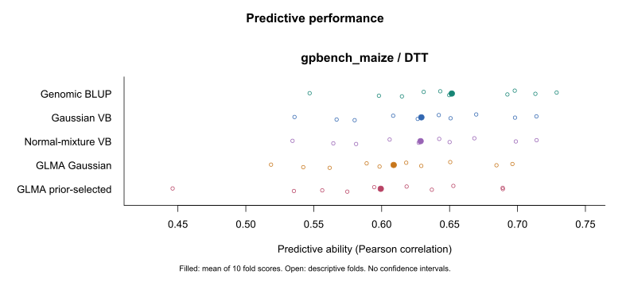
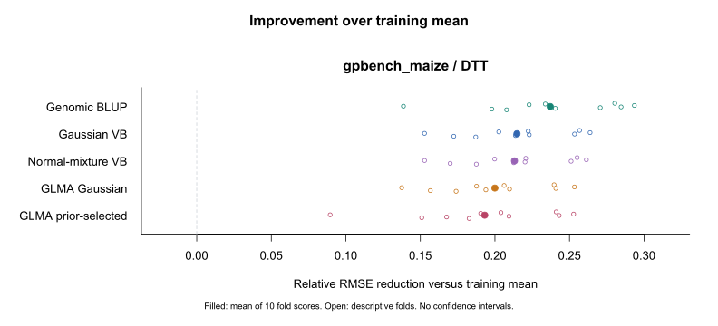
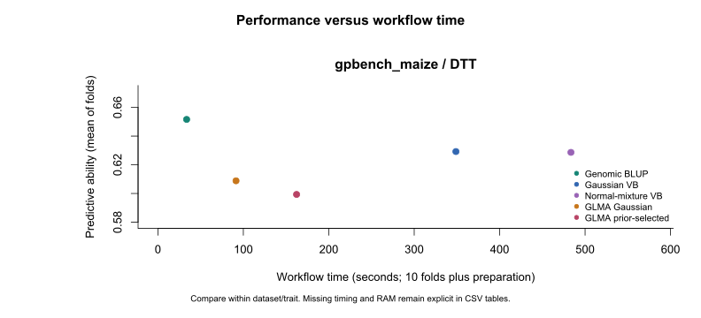
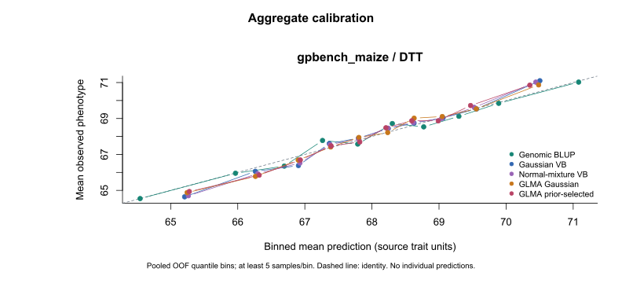

# Maize: gsuite prediction models

## Scientific question and dataset

Predict supplied phenotypes using all source markers and the published GPBench ten-fold split algorithm. Original IDs, upstream processing and phenotype units remain unverified.

| Dataset | Species | Trait | Individuals Evaluated | Observed Targets | Imputed Targets | Available markers | Markers Used |
| --- | --- | --- | --- | --- | --- | --- | --- |
| gpbench_maize | Zea mays | DTT | 1458 | 1456 | 2 | 75304 | 75304 |

[Full dataset catalogue and source definitions](../assets/reports/20261121-glma-mkl/maize/dataset_catalogue.csv)

## Methods and validation

Shuffled ten-fold KFold, seed 42, scikit-learn 1.6.1 and NumPy 1.26.4. Every method receives the same saved splits and all supplied dosage columns. Genomic BLUP estimates variances by REML through greml/gsolve, using K=ZZt/p. gbayes Gaussian and sparse normal-mixture VB use fixed working h2=0.5 and training-only phenotype/marker variances; the mixture fixes inclusion probability at 0.1. These three methods use raw dosage coordinates without SD scaling.

GLMA Gaussian and GLMA prior-selected are the full-marker prediction fits underlying glma_infinitesimal_loco() and glma_prior_selected_loco(), respectively. They use the existing native joint fitting modes, without chromosome exclusions or association calibration. GPBench has no chromosome maps; none are invented. Within each outer training fold, GLMA standardizes markers by empirical SD, estimates variance using blocked RHE/Monte Carlo refinement, and uses its internal 10% validation split (seed 17092026). Prior-selected compares ten ridge/elastic candidates; Gaussian uses ridge. The native joint selection/variance procedure sees only outer training outcomes. Its inner selection score is not an external accuracy estimate. Constant training markers are excluded from standardized fitting and receive zero prediction effects; actual counts are in fold/results CSVs.

The methods share external validation, but differ in preprocessing, prior models, variance estimation and acceptance criteria. Their timings compare complete workflows and do not isolate solver speed. No outer test outcomes enter fitting or prior selection beyond the explicitly reproduced phenotype-imputation rule below.

To reproduce GPBench, missing phenotypes are mean-imputed before splitting. Two maize DTT targets are imputed; cattle has none. Imputed labels are not genuinely observed phenotypes. The observed-target-only sensitivity summary excludes them from evaluation. This reproduction does not endorse whole-dataset phenotype imputation for a new scientific study.

| Method | Package | Package Version | Native Engines | Tuning | Convergence |
| --- | --- | --- | --- | --- | --- |
| gblup_reml | gsuite | 0.43.0 | greml 0.92.0; gsolve 0.28.0 | No test-fold tuning | Score tolerance 1e-04 ; hybrid EM-AI; requested direct threads 4; returned backend settings in fold CSV; cap 100 |
| gbayes_gaussian | gbayes | 0.1.16 | gbayes native streamed variational prediction | No tuning; training var(y) split h2=0.5; average effect variance=0.5*var(y)/sum(training marker variances); mixture nonzero variance divided by 0.1 | Per-sample negative-ELBO stabilization; tolerance 1e-06 ; sweep cap 100 ; chunk 128; local iterations 20; full refresh 8; one worker; managed 1 GiB; Gram cache 256 MiB |
| gbayes_mixture | gbayes | 0.1.16 | gbayes native streamed variational prediction | No tuning; training var(y) split h2=0.5; average effect variance=0.5*var(y)/sum(training marker variances); mixture nonzero variance divided by 0.1 | Per-sample negative-ELBO stabilization; tolerance 1e-06 ; sweep cap 100 ; chunk 128; local iterations 20; full refresh 8; one worker; managed 1 GiB; Gram cache 256 MiB |
| glma_infinitesimal | glma | 0.1.2 | glma 0.1.2; gbayes; greml; gsolve MKL | Blocked RHE/MC heritability grid; inner 10% validation within each outer training fold; split seed 17092026; no outer test outcomes | Native approximate joint workflow acceptance; prediction stability and adaptive chunk retirement; default sweep cap 100; chunk 256; four coordinate/MKL threads; managed 1 GiB |
| glma_prior_selected | glma | 0.1.2 | glma 0.1.2; gbayes; greml; gsolve MKL | Blocked RHE/MC heritability grid; inner 10% validation within each outer training fold; split seed 17092026; no outer test outcomes | Native approximate joint workflow acceptance; prediction stability and adaptive chunk retirement; default sweep cap 100; chunk 256; four coordinate/MKL threads; managed 1 GiB |

[Full model and method settings](../assets/reports/20261121-glma-mkl/maize/method_settings.csv)

Fitting calls gsuite::gs_lmm_fit, gbayes::bayes or the thin glma::glma_full_marker_prediction adapter to our compiled libraries. The GLMA adapter exposes existing C++ fitting and returns effects for a held-out forward prediction; it implements no new estimator. R bindings live in gsuite; native cores have their own repositories. Exact source commits are pinned below; implementation source and binaries remain private.

| Software | Version | Private Source Commit | Execution |
| --- | --- | --- | --- |
| gsuite | 0.43.0 | [19f876e71df0](https://github.com/psoerensen/gsuite/tree/19f876e71df014b996dbd09d0ae01ab3d0709829) | earlier reviewed executions |
| greml | 0.92.0 | [c84f83409e7a](https://github.com/psoerensen/greml/tree/c84f83409e7a08eeada20e854c6ff6c81c8ed25f) | earlier reviewed executions |
| gsolve | 0.28.0 | [dd405973d6ae](https://github.com/psoerensen/gsolve/tree/dd405973d6aece137fb9d82367502f78c8feef2d) | earlier reviewed executions |
| gbayes | 0.1.16 (R package) | [67e8bdf1b617](https://github.com/psoerensen/gbayes/tree/67e8bdf1b617272e65174399889926c92ca11706) | earlier reviewed executions |
| gsolve | portable copy embedded in gbase for earlier gbayes runs | [8aa261a6b92b](https://github.com/psoerensen/gsolve/tree/8aa261a6b92b0cfed2adf3bad83983e54c698ed0) | 20261121-gbayes |
| gsuite | 0.43.0 | [7d87cbde35bd](https://github.com/psoerensen/gsuite/tree/7d87cbde35bd0459ddcb6573457e34fe48ae1bd6) | 20261121-glma-mkl |
| greml | 0.92.0 | [c84f83409e7a](https://github.com/psoerensen/greml/tree/c84f83409e7a08eeada20e854c6ff6c81c8ed25f) | 20261121-glma-mkl |
| gsolve | 0.28.0 | [dd405973d6ae](https://github.com/psoerensen/gsolve/tree/dd405973d6aece137fb9d82367502f78c8feef2d) | 20261121-glma-mkl |
| gbayes | 0.1.0 (native core) | [67e8bdf1b617](https://github.com/psoerensen/gbayes/tree/67e8bdf1b617272e65174399889926c92ca11706) | 20261121-glma-mkl |
| glma | 0.1.2 | [0d7a23aa88d5](https://github.com/psoerensen/glma/tree/0d7a23aa88d5fdddb4232c33ec1b8afe832653e0) | 20261121-glma-mkl |
| gbits | 0.21.0 | [fadd3cc38103](https://github.com/psoerensen/gbits/tree/fadd3cc3810394151f5ea19f908ab1c77f835345) | 20261121-glma-mkl |
| gmat | 0.7.0 | [3f96a48cbf03](https://github.com/psoerensen/gmat/tree/3f96a48cbf030b5d5975263887f02695c709ca10) | 20261121-glma-mkl |

[Software and source commits](../assets/reports/20261121-glma-mkl/maize/software_sources.csv)

## Results

Main scores are arithmetic means of ten test-fold metrics, matching GPBench. Predictive R2 uses each test fold mean as its reference. Descriptive fold standard deviations use NumPy ddof=0; no confidence intervals or independent fold replicates are implied. Pooled OOF metrics are separate.

| Dataset | Trait | Method | Predictive ability | RMSE | Predictive R² | Calibration Slope | Fit (s) | Predict (s) | Kernel Seconds | Workflow Seconds | Status |
| --- | --- | --- | --- | --- | --- | --- | --- | --- | --- | --- | --- |
| gpbench_maize | DTT | gblup_reml | 0.65162 | 2.1753 | 0.41319 | 1.0001 | 31.80 | 0.02 | 1.81 | 33.63 | completed |
| gpbench_maize | DTT | gbayes_gaussian | 0.62923 | 2.2410 | 0.37933 | 1.1770 | 345.69 | 0.67 | 0.00 | 348.80 | completed |
| gpbench_maize | DTT | gbayes_mixture | 0.62866 | 2.2459 | 0.37670 | 1.2014 | 480.16 | 0.75 | 0.00 | 483.44 | completed |
| gpbench_maize | DTT | glma_infinitesimal | 0.60884 | 2.2833 | 0.35564 | 1.1503 | 89.48 | 0.20 | 0.00 | 91.43 | completed |
| gpbench_maize | DTT | glma_prior_selected | 0.59934 | 2.3014 | 0.34377 | 1.1742 | 160.41 | 0.22 | 0.00 | 162.32 | completed |

[Results CSV](../assets/reports/20261121-glma-mkl/maize/benchmark_results.csv) · [Fold values](../assets/reports/20261121-glma-mkl/maize/fold_results.csv) · [Pooled OOF](../assets/reports/20261121-glma-mkl/maize/pooled_results.csv) · [Observed targets only](../assets/reports/20261121-glma-mkl/maize/observed_only_metrics.csv)

## Performance and computational cost

<figure class="report-figure"></figure>

[Full-size performance SVG](../assets/reports/20261121-glma-mkl/maize/performance.svg)

<figure class="report-figure"></figure>

[Full-size improvement SVG](../assets/reports/20261121-glma-mkl/maize/improvement.svg)

<figure class="report-figure"></figure>

[Full-size runtime SVG](../assets/reports/20261121-glma-mkl/maize/runtime.svg)

Workflow seconds include method-specific preparation, ten fits and ten predictions. greml/gsolve includes its reusable raw-dosage kernel and fold blocks. gbayes preparation includes training/target extraction and fitting includes prior calculations. GLMA preparation includes one dosage-only BED cache and target extraction; fitting includes packing training rows, training-marker standardization, RHE/MC variance estimation, candidate selection and the global refit. Each GLMA method is charged the full reusable cache cost once. Native timings exclude verbose tracing. These are single-execution measurements; peak RAM is unmeasured. Zero seconds means below timer resolution.

Reviewed earlier executions are retained; added methods were measured in separate sequential execution batches on the same hardware and saved folds. Run IDs, source revisions, fitting sessions and backend descriptions distinguish the measurements.

R uses OpenBLAS with four threads. greml/gsolve uses its MKL/CHOLMOD native backend, which reports one component-backend worker. GLMA uses the full native MKL prefix with four requested coordinate/MKL workers; a separate numerical check verified actual MKL DGEMM calls. The earlier gbayes standalone measurements use a portable compiled core without MKL dense kernels and report one worker: R OpenBLAS does not accelerate that core automatically. These backend differences must be considered when comparing times. Returned thread settings do not measure CPU utilization.

greml acceptance is REML convergence at the declared tolerance. gbayes acceptance is negative-ELBO stabilization. GLMA acceptance is its native approximate joint workflow rule, including prediction stability and adaptive chunk retirement; it is not exact REML or a strict global ELBO certificate. Failed and provisional fits remain explicit.

## Calibration, convergence and solver checks

<figure class="report-figure"></figure>

[Full-size calibration SVG](../assets/reports/20261121-glma-mkl/maize/calibration.svg) · [Aggregate bins](../assets/reports/20261121-glma-mkl/maize/calibration_bins.csv)

| Dataset | Method | Fold | Status | Convergence | Warning Count |
| --- | --- | --- | --- | --- | --- |
| gpbench_maize | gblup_reml | 1 | completed | converged | 0 |
| gpbench_maize | gblup_reml | 2 | completed | converged | 0 |
| gpbench_maize | gblup_reml | 3 | completed | converged | 0 |
| gpbench_maize | gblup_reml | 4 | completed | converged | 0 |
| gpbench_maize | gblup_reml | 5 | completed | converged | 0 |
| gpbench_maize | gblup_reml | 6 | completed | converged | 0 |
| gpbench_maize | gblup_reml | 7 | completed | converged | 0 |
| gpbench_maize | gblup_reml | 8 | completed | converged | 0 |
| gpbench_maize | gblup_reml | 9 | completed | converged | 0 |
| gpbench_maize | gblup_reml | 10 | completed | converged | 0 |
| gpbench_maize | gbayes_gaussian | 1 | completed | converged | 0 |
| gpbench_maize | gbayes_mixture | 1 | completed | converged | 0 |
| gpbench_maize | gbayes_gaussian | 2 | completed | converged | 0 |
| gpbench_maize | gbayes_mixture | 2 | completed | converged | 0 |
| gpbench_maize | gbayes_gaussian | 3 | completed | converged | 0 |
| gpbench_maize | gbayes_mixture | 3 | completed | converged | 0 |
| gpbench_maize | gbayes_gaussian | 4 | completed | converged | 0 |
| gpbench_maize | gbayes_mixture | 4 | completed | converged | 0 |
| gpbench_maize | gbayes_gaussian | 5 | completed | converged | 0 |
| gpbench_maize | gbayes_mixture | 5 | completed | converged | 0 |
| gpbench_maize | gbayes_gaussian | 6 | completed | converged | 0 |
| gpbench_maize | gbayes_mixture | 6 | completed | converged | 0 |
| gpbench_maize | gbayes_gaussian | 7 | completed | converged | 0 |
| gpbench_maize | gbayes_mixture | 7 | completed | converged | 0 |
| gpbench_maize | gbayes_gaussian | 8 | completed | converged | 0 |
| gpbench_maize | gbayes_mixture | 8 | completed | converged | 0 |
| gpbench_maize | gbayes_gaussian | 9 | completed | converged | 0 |
| gpbench_maize | gbayes_mixture | 9 | completed | converged | 0 |
| gpbench_maize | gbayes_gaussian | 10 | completed | converged | 0 |
| gpbench_maize | gbayes_mixture | 10 | completed | converged | 0 |
| gpbench_maize | glma_infinitesimal | 1 | completed | accepted native joint workflow | 0 |
| gpbench_maize | glma_prior_selected | 1 | completed | accepted native joint workflow | 0 |
| gpbench_maize | glma_infinitesimal | 2 | completed | accepted native joint workflow | 0 |
| gpbench_maize | glma_prior_selected | 2 | completed | accepted native joint workflow | 0 |
| gpbench_maize | glma_infinitesimal | 3 | completed | accepted native joint workflow | 0 |
| gpbench_maize | glma_prior_selected | 3 | completed | accepted native joint workflow | 0 |
| gpbench_maize | glma_infinitesimal | 4 | completed | accepted native joint workflow | 0 |
| gpbench_maize | glma_prior_selected | 4 | completed | accepted native joint workflow | 0 |
| gpbench_maize | glma_infinitesimal | 5 | completed | accepted native joint workflow | 0 |
| gpbench_maize | glma_prior_selected | 5 | completed | accepted native joint workflow | 0 |
| gpbench_maize | glma_infinitesimal | 6 | completed | accepted native joint workflow | 0 |
| gpbench_maize | glma_prior_selected | 6 | completed | accepted native joint workflow | 0 |
| gpbench_maize | glma_infinitesimal | 7 | completed | accepted native joint workflow | 0 |
| gpbench_maize | glma_prior_selected | 7 | completed | accepted native joint workflow | 0 |
| gpbench_maize | glma_infinitesimal | 8 | completed | accepted native joint workflow | 0 |
| gpbench_maize | glma_prior_selected | 8 | completed | accepted native joint workflow | 0 |
| gpbench_maize | glma_infinitesimal | 9 | completed | accepted native joint workflow | 0 |
| gpbench_maize | glma_prior_selected | 9 | completed | accepted native joint workflow | 0 |
| gpbench_maize | glma_infinitesimal | 10 | completed | accepted native joint workflow | 0 |
| gpbench_maize | glma_prior_selected | 10 | completed | accepted native joint workflow | 0 |

The following fixed-variance gsolve check uses the variance estimates from our greml fit on representative folds: cattle folds 1 and 9 (including the previously problematic fold), maize fold 1. It checks prediction equivalence; its solve time excludes REML and is not another complete-method timing.

| Fold | Status | Max Prediction Difference | Prediction Correlation | Elapsed Seconds | Requested Workers | Stage | Dataset | Trait |
| --- | --- | --- | --- | --- | --- | --- | --- | --- |
| 1 | converged | 1.9657e-08 | 1 | 2.12 | 1 | representative-fold fixed-variance GLS/BLUP; two RHS; REML excluded | gpbench_maize | DTT |

[Solver checks CSV](../assets/reports/20261121-glma-mkl/maize/solver_checks.csv)

## Reproduce

Build and activate the pinned environment using environment/README.md in the repository. Set external GPCT_DATA_DIR and GPCT_OUTPUT_DIR; acknowledge positional alignment. Then run scripts/prepare.R CASE, benchmarks/CASE_prediction/run.R, scripts/check_solvers.R RUN_DIRECTORY and scripts/report_prediction.R RUN_DIRECTORY.

[Run metadata](../assets/reports/20261121-glma-mkl/maize/run_metadata.csv) · [Recipe checksums](../assets/reports/20261121-glma-mkl/maize/recipe_checksums.csv) · [Reporting session](../assets/reports/20261121-glma-mkl/maize/report-sessionInfo.txt)

Individual predictions, fold assignments, saved fits, raw diagnostics, private implementation source and binaries stay outside the public repository.

[R packages loaded during fitting](../assets/reports/20261121-glma-mkl/maize/fit-sessionInfo.txt)

## GLMA fitting diagnostics

[Per-fold selected priors, native acceptance, marker counts and phase timings](../assets/reports/20261121-glma-mkl/maize/glma_fit_diagnostics.csv)

These are aggregate fit diagnostics; no individual predictions or inner validation identities are published.

## R interface timing check

A separate repeat of fold one traces the native Rcpp .Call boundary. It is excluded from benchmark timing totals. Native-call time includes C++ packing, setup and conversion; the inner fitter timer excludes those phases. The difference between the R fitting call and .Call is the measured outside-native wrapper cost, at the coarse elapsed timer resolution. It does not include dataset loading, report generation or the separately recorded target prediction.

| Dataset | Method | r Fit Call Seconds | Native Call Seconds | Native Inner Fit Seconds | Outside Native Call Seconds | Native Preparation and Conversion Seconds |
| --- | --- | --- | --- | --- | --- | --- |
| gpbench_maize | glma_infinitesimal | 6.87 | 6.87 | 4.4211 | 0 | 2.4489 |
| gpbench_maize | glma_prior_selected | 14.36 | 14.36 | 11.6360 | 0 | 2.7243 |

[Interface timing check CSV](../assets/reports/20261121-glma-mkl/maize/glma_interface_cost.csv)

[Comparison input-identity checks](../assets/reports/20261121-glma-mkl/maize/identity_checks.csv)
