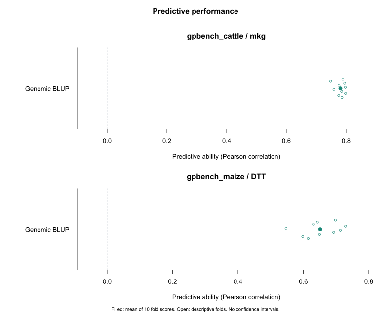
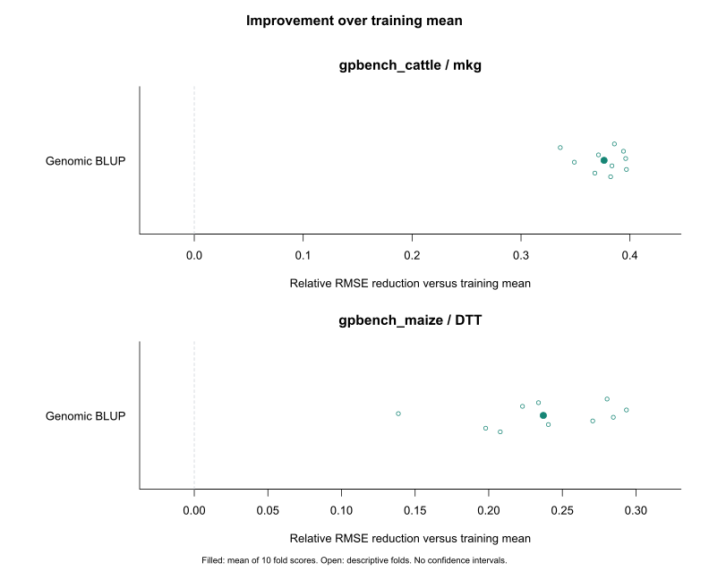
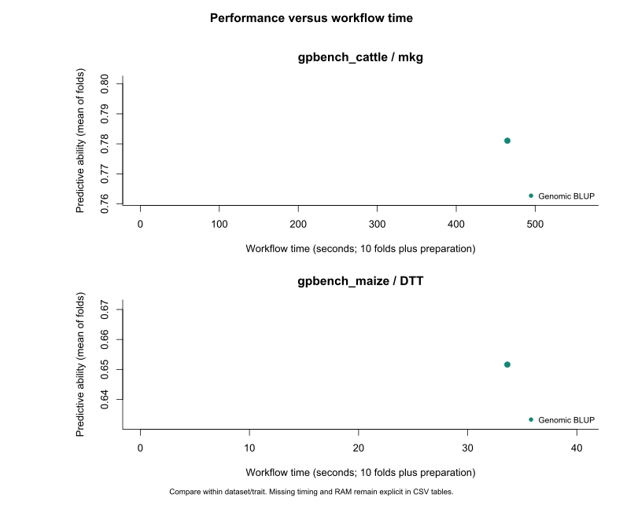
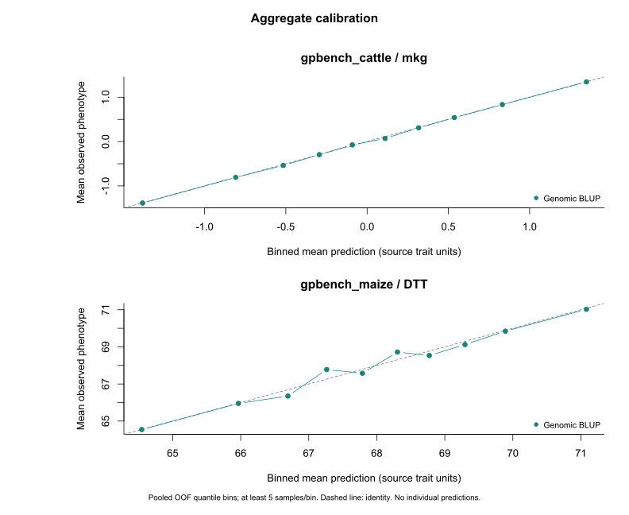

# Results and timings

These benchmarks evaluate **genomic BLUP implemented in the gsuite ecosystem**, using greml for REML and gsolve for numerical operations. Both full-marker cases completed ten folds. External statistical fitters are outside gpct's scope.

## What was compared?

| Dataset | Species | Trait | Individuals Evaluated | Observed Targets | Imputed Targets | Available markers | Markers Used |
| --- | --- | --- | --- | --- | --- | --- | --- |
| gpbench_cattle | Bos taurus | mkg | 5024 | 5024 | 0 | 42551 | 42551 |
| gpbench_maize | Zea mays | DTT | 1458 | 1456 | 2 | 75304 | 75304 |

[Dataset catalogue CSV](assets/reports/20261121-gsuite-final/dataset_catalogue.csv)

One prediction model is currently measured in each case. Other gsuite models will receive separate entries after execution and review. gsolve is an engine supporting this model, not another model in the ranking.

The model has an intercept and raw-dosage covariance K=ZZ'/p. Genetic and residual variances are estimated by REML within each training fold. The existing hybrid EM–AI optimizer uses score tolerance 1e-4 and at most 100 iterations. There is no test-fold tuning.

[Method settings and versions](assets/reports/20261121-gsuite-final/method_settings.csv)

Fitting calls gsuite::gs_lmm_fit through our R interface to the compiled greml/gsolve libraries. The implementation source is private; authorized maintainers can use these exact repository commits.

| Software | Version | Private Source Commit |
| --- | --- | --- |
| gsuite | 0.43.0 | [19f876e71df0](https://github.com/psoerensen/gsuite/tree/19f876e71df014b996dbd09d0ae01ab3d0709829) |
| greml | 0.92.0 | [c84f83409e7a](https://github.com/psoerensen/greml/tree/c84f83409e7a08eeada20e854c6ff6c81c8ed25f) |
| gsolve | 0.28.0 | [dd405973d6ae](https://github.com/psoerensen/gsolve/tree/dd405973d6aece137fb9d82367502f78c8feef2d) |

[Software and exact source commits](assets/reports/20261121-gsuite-final/software_sources.csv)

Validation matches the pinned GPBench regression scheme: all markers, shuffled scikit-learn ten-fold KFold with seed 42, and arithmetic means of test-fold metrics. Two maize DTT targets are mean-imputed before splitting to match the source rule; an observed-target-only evaluation is supplied separately. See the [protocol](protocol.html).

## How well did it work, and what did it cost?

| Dataset | Model | Correlation | RMSE | Predictive R2 | Calibration Slope | Fit Seconds | Prediction Seconds | Kernel Seconds | Workflow Seconds | Status | Recipe | Report |
| --- | --- | --- | --- | --- | --- | --- | --- | --- | --- | --- | --- | --- |
| Cattle / mkg | Genomic BLUP: greml/gsolve | 0.7810 | 0.6235 | 0.6081 | 1.0000 | 453.07 | 0.05 | 11.65 | 464.77 | 10/10 converged | [Recipe](https://github.com/psoerensen/gpct/tree/main/benchmarks/cattle_prediction) | [Cattle](reports/cattle.html) |
| Maize / DTT | Genomic BLUP: greml/gsolve | 0.6516 | 2.1753 | 0.4132 | 1.0001 | 31.80 | 0.02 | 1.81 | 33.63 | 10/10 converged | [Recipe](https://github.com/psoerensen/gpct/tree/main/benchmarks/maize_prediction) | [Maize](reports/maize.html) |

[Results CSV](assets/reports/20261121-gsuite-final/benchmark_results.csv)
 ·
[Fold results](assets/reports/20261121-gsuite-final/fold_results.csv)
 ·
[Pooled OOF metrics](assets/reports/20261121-gsuite-final/pooled_results.csv)
 ·
[Observed targets only](assets/reports/20261121-gsuite-final/observed_only_metrics.csv)

Correlation is predictive ability. Predictive R² uses the test-fold mean as its reference and is not squared correlation. Fold variation is descriptive; no confidence intervals or independent fold replicates are implied. Compare methods within each dataset–trait combination; RMSE values have different source units.

Workflow time includes the shared genotype-only kernel, fold block preparation and all ten fitting/prediction calls. Fitting includes relationship preparation and REML. Whole-case time, including loading and saving, is in the results CSV. Reporting and solver checks run afterward and are excluded. Recorded zero seconds means below elapsed timer resolution. Timings describe one execution; peak RAM was not measured.

Hardware: Intel Core Ultra 7 258V, 8 logical processors, 32 GiB RAM; R 4.4.3, gsuite 0.43.0, greml 0.92.0 and gsolve 0.28.0. R uses OpenBLAS 0.3.29; the native component path uses CHOLMOD/MKL. OpenBLAS/MKL environment settings request four threads. The component backend returns requested/resolved/support settings of one in this build, preserved in fold results. These settings do not measure CPU utilization.

<figure class="report-figure"></figure>

[Open full-size performance SVG](assets/reports/20261121-gsuite-final/performance.svg)

<figure class="report-figure"></figure>

[Open full-size improvement SVG](assets/reports/20261121-gsuite-final/improvement.svg)

<figure class="report-figure"></figure>

[Open full-size runtime SVG](assets/reports/20261121-gsuite-final/runtime.svg)

<figure class="report-figure"></figure>

[Open full-size calibration SVG](assets/reports/20261121-gsuite-final/calibration.svg)

The improvement reference predicts the training-fold mean; it does not call an external fitting package. Calibration uses reviewed aggregate quantile bins with at least five individuals per bin. Individual predictions remain local.

## Numerical verification and published context

An earlier cattle attempt at score tolerance 1e-6 completed nine folds but failed the likelihood-step acceptance check in fold nine (202.22 seconds). The final benchmarks rerun every fold at the common score tolerance 1e-4. The failed attempt remains disclosed and is excluded from final-run timing. Predictions are checked against the nine successful stricter fits.

[Earlier attempt statuses and costs](assets/reports/20261121-gsuite-final/earlier_attempts.csv)
 ·
[Prediction sensitivity to convergence tolerance](assets/reports/20261121-gsuite-final/tolerance_comparison.csv)

Every fit converged without warnings or failed folds. A separate one-worker gsolve check uses our greml variance estimates to recompute GLS/BLUP predictions on representative folds: cattle 1 and 9 (including the earlier failure), maize 1. Its timing excludes REML and is not a second model result.

[Fixed-variance solver checks](assets/reports/20261121-gsuite-final/solver_checks.csv)

The following values are published GPBench rrBLUP aggregates, included as context. We did not execute its external fitter. Rounded agreement does not independently verify undocumented upstream processing.

| Dataset | Reference Method | Our Correlation | Gpbench Correlation | Our r Squared | Gpbench r Squared |
| --- | --- | --- | --- | --- | --- |
| gpbench_cattle | rrBLUP | 0.78103 | 0.7810 | 0.60815 | 0.6081 |
| gpbench_maize | rrBLUP | 0.65162 | 0.6516 | 0.41319 | 0.4131 |

[Published-reference comparison and source links](assets/reports/20261121-gsuite-final/reference_comparison.csv)

## Reproduce and inspect

Use the [benchmark recipes](benchmarks.html) and [pinned environment](https://github.com/psoerensen/gpct/tree/main/environment). Public files contain thin calls, settings and reviewed aggregates. Numerical implementation source and binaries remain in private gsuite repositories.

[Run metadata](assets/reports/20261121-gsuite-final/run_metadata.csv)
 ·
[Recipe checksums](assets/reports/20261121-gsuite-final/recipe_checksums.csv)
 ·
[Native binary identities](assets/reports/20261121-gsuite-final/native_runtime_checksums.csv)
 ·
[Reporting session](assets/reports/20261121-gsuite-final/report-sessionInfo.txt)
 ·
[R packages loaded during fitting](assets/reports/20261121-gsuite-final/fit-sessionInfo.txt)

[Verification record](verification.html). Individual data, predictions, folds, saved fits and raw diagnostics stay external.
