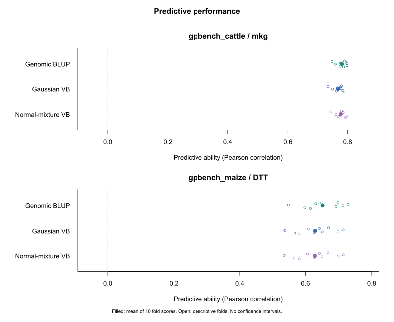
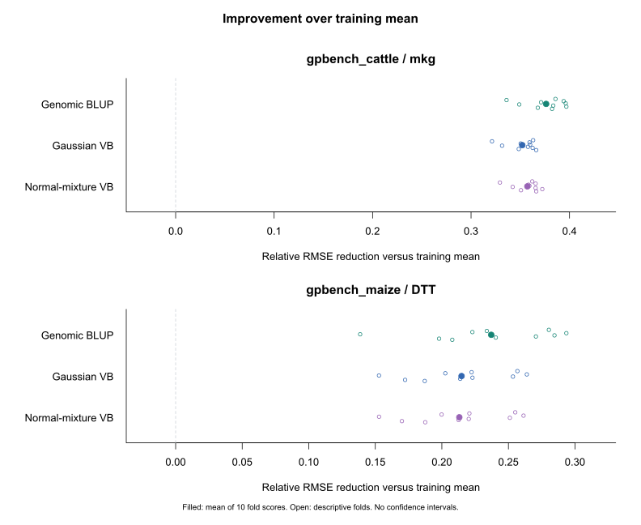
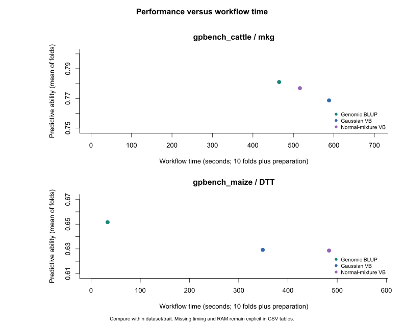
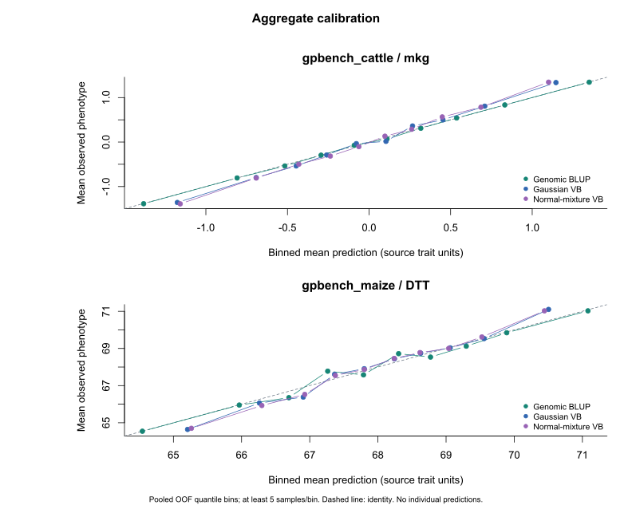

# Results and timings

Three prediction models implemented in the **gsuite ecosystem** are evaluated on cattle and maize using the same saved GPBench ten-fold partitions and all supplied markers. greml/gsolve fits genomic BLUP with REML. gbayes fits Gaussian VB and sparse normal-mixture VB through its existing native streamed interface.

## What was compared?

| Dataset | Species | Trait | Individuals Evaluated | Observed Targets | Imputed Targets | Available markers | Markers Used |
| --- | --- | --- | --- | --- | --- | --- | --- |
| gpbench_cattle | Bos taurus | mkg | 5024 | 5024 | 0 | 42551 | 42551 |
| gpbench_maize | Zea mays | DTT | 1458 | 1456 | 2 | 75304 | 75304 |

[Full dataset catalogue](assets/reports/20261121-gsuite-models/dataset_catalogue.csv)

Genomic BLUP estimates genetic and residual variances within each training fold. Both gbayes models use fixed working h2=0.5: residual variance is half the training phenotype variance, and average marker variance is the other half divided by the sum of training marker variances. The mixture has a zero spike of probability 0.9 and a normal component of probability 0.1; its nonzero variance is ten times the Gaussian marker variance. These are declared benchmark priors, without test-fold tuning.

Raw dosage coordinates are preserved. The gbayes native interface projects the training intercept and recovers it for target prediction; it performs no SD normalization or marker filtering. The full-marker streamed route avoids a global marker-by-marker Gram matrix.

[Exact model settings and convergence controls](assets/reports/20261121-gsuite-models/method_settings.csv)
 ·
[Per-fold priors, sweeps, metrics and status](assets/reports/20261121-gsuite-models/fold_results.csv)

## How well did it work?

| Dataset | Model | Correlation | RMSE | Predictive R2 | Calibration Slope | Status | Report |
| --- | --- | --- | --- | --- | --- | --- | --- |
| Cattle / mkg | [Genomic BLUP](https://github.com/psoerensen/gpct/tree/c75423fbc69fab75141241b347fa715dc6f214e4/benchmarks/cattle_prediction) | 0.7810 | 0.6235 | 0.6081 | 1.0000 | 10/10 converged | [Cattle](reports/cattle.html) |
| Cattle / mkg | [Gaussian VB](https://github.com/psoerensen/gpct/tree/ef46c2b48c292223787ecce7686826982b0db585/benchmarks/cattle_prediction) | 0.7686 | 0.6478 | 0.5774 | 1.1560 | 10/10 converged | [Cattle](reports/cattle.html) |
| Cattle / mkg | [Normal-mixture VB](https://github.com/psoerensen/gpct/tree/ef46c2b48c292223787ecce7686826982b0db585/benchmarks/cattle_prediction) | 0.7769 | 0.6427 | 0.5841 | 1.2003 | 10/10 converged | [Cattle](reports/cattle.html) |
| Maize / DTT | [Genomic BLUP](https://github.com/psoerensen/gpct/tree/c75423fbc69fab75141241b347fa715dc6f214e4/benchmarks/maize_prediction) | 0.6516 | 2.1753 | 0.4132 | 1.0001 | 10/10 converged | [Maize](reports/maize.html) |
| Maize / DTT | [Gaussian VB](https://github.com/psoerensen/gpct/tree/ef46c2b48c292223787ecce7686826982b0db585/benchmarks/maize_prediction) | 0.6292 | 2.2410 | 0.3793 | 1.1770 | 10/10 converged | [Maize](reports/maize.html) |
| Maize / DTT | [Normal-mixture VB](https://github.com/psoerensen/gpct/tree/ef46c2b48c292223787ecce7686826982b0db585/benchmarks/maize_prediction) | 0.6287 | 2.2459 | 0.3767 | 1.2014 | 10/10 converged | [Maize](reports/maize.html) |

[Full benchmark results CSV](assets/reports/20261121-gsuite-models/benchmark_results.csv)
 ·
[Pooled OOF scores](assets/reports/20261121-gsuite-models/pooled_results.csv)
 ·
[Observed-target-only sensitivity](assets/reports/20261121-gsuite-models/observed_only_metrics.csv)

Main scores are arithmetic means of ten test-fold metrics. Predictive R² uses the test-fold mean as its reference and is not squared correlation. Fold variation is descriptive; folds are not independent experimental replicates and no confidence intervals are implied. Compare RMSE within each dataset–trait combination because source units differ.

## What did it cost?

| Dataset | Model | Preparation Seconds | Fit Seconds | Prediction Seconds | Workflow Seconds | Peak RAM |
| --- | --- | --- | --- | --- | --- | --- |
| Cattle / mkg | Genomic BLUP | 11.65 | 453.07 | 0.05 | 464.77 | Not measured |
| Cattle / mkg | Gaussian VB | 5.39 | 581.28 | 1.39 | 588.06 | Not measured |
| Cattle / mkg | Normal-mixture VB | 5.22 | 509.51 | 1.29 | 516.02 | Not measured |
| Maize / DTT | Genomic BLUP | 1.81 | 31.80 | 0.02 | 33.63 | Not measured |
| Maize / DTT | Gaussian VB | 2.44 | 345.69 | 0.67 | 348.80 | Not measured |
| Maize / DTT | Normal-mixture VB | 2.53 | 480.16 | 0.75 | 483.44 | Not measured |

Preparation includes the raw-dosage kernel and fold blocks for greml/gsolve, or training/target matrix extraction for gbayes. Fitting includes method-specific setup, training-prior calculations and the native fit. Workflow time sums preparation, ten fits and ten predictions. Case-wide elapsed time includes loading/saving and is kept separately in the CSV. Peak RAM was not measured.

These are single-execution elapsed timings on an Intel Core Ultra 7 258V, 8 logical processors and 32 GiB RAM. The reviewed greml/gsolve run is retained; gbayes is an additional execution batch on the same hardware, R/OpenBLAS binary and saved splits. Input MD5s, OOF identities/outcomes, imputed-target flags and training means were checked for equality before combining. Run IDs distinguish the batches.

[Checks establishing the shared benchmark inputs](assets/reports/20261121-gsuite-models/identity_checks.csv)
 ·
[Run identities, hardware and BLAS](assets/reports/20261121-gsuite-models/run_metadata.csv)

R/OpenBLAS and MKL environment settings request four threads. The greml component backend reports requested/resolved/support settings of one in this build; gbayes requests and reports one package worker. These settings do not measure CPU utilization. Variational convergence means native negative-ELBO stabilization, not a global mixture optimum. Failed and provisional fits remain explicitly labelled.

## Software and source

R 4.4.3 uses OpenBLAS 0.3.29. greml/gsolve uses the CHOLMOD/MKL component path; gbayes uses its compiled streamed variational prediction engine. The gbayes R bindings are in gsuite, while its native core has its own repository. Private implementation source and binaries are not distributed by gpct.

| Software | Version | Private Source Commit |
| --- | --- | --- |
| gsuite | 0.43.0 | [19f876e71df0](https://github.com/psoerensen/gsuite/tree/19f876e71df014b996dbd09d0ae01ab3d0709829) |
| greml | 0.92.0 | [c84f83409e7a](https://github.com/psoerensen/greml/tree/c84f83409e7a08eeada20e854c6ff6c81c8ed25f) |
| gsolve | 0.28.0 | [dd405973d6ae](https://github.com/psoerensen/gsolve/tree/dd405973d6aece137fb9d82367502f78c8feef2d) |
| gbayes | 0.1.16 (R package) | [67e8bdf1b617](https://github.com/psoerensen/gbayes/tree/67e8bdf1b617272e65174399889926c92ca11706) |

[Software versions and exact source commits](assets/reports/20261121-gsuite-models/software_sources.csv)
 ·
[Native binary identities](assets/reports/20261121-gsuite-models/native_runtime_checksums.csv)
 ·
[Measured recipe hashes and Git commits](assets/reports/20261121-gsuite-models/recipe_checksums.csv)
 ·
[R packages loaded during fitting](assets/reports/20261121-gsuite-models/fit-sessionInfo.txt)

## Performance, cost and calibration plots

<figure class="report-figure"></figure>

[Open full-size performance SVG](assets/reports/20261121-gsuite-models/performance.svg)

<figure class="report-figure"></figure>

[Open full-size improvement SVG](assets/reports/20261121-gsuite-models/improvement.svg)

<figure class="report-figure"></figure>

[Open full-size runtime SVG](assets/reports/20261121-gsuite-models/runtime.svg)

<figure class="report-figure"></figure>

[Open full-size calibration SVG](assets/reports/20261121-gsuite-models/calibration.svg)

The improvement reference predicts the training-fold mean. Calibration publishes only aggregate quantile bins with at least five individuals. Individual predictions remain local. GPBench mean-imputes two missing maize DTT values before splitting; the observed-target-only evaluation excludes those targets from scoring while retaining the same fits. See the [protocol](protocol.html).

## Published reference and numerical checks

The following published GPBench rrBLUP aggregates provide context for our genomic BLUP implementation. Its external fitter was not executed. Its hardware timing is not a controlled comparison with ours. Rounded agreement does not establish identical undocumented upstream processing.

| Dataset | Reference Method | Our Correlation | Gpbench Correlation | Our r Squared | Gpbench r Squared |
| --- | --- | --- | --- | --- | --- |
| gpbench_cattle | rrBLUP | 0.78103 | 0.7810 | 0.60815 | 0.6081 |
| gpbench_maize | rrBLUP | 0.65162 | 0.6516 | 0.41319 | 0.4131 |

[Published reference and its source](assets/reports/20261121-gsuite-models/reference_comparison.csv)

The retained greml/gsolve fits use score tolerance 1e-4. The earlier cattle attempt at 1e-6 failed the likelihood-step acceptance check in fold nine after 202.22 seconds; its status and costs remain disclosed separately. Separate representative-fold gsolve checks verify GLS/BLUP predictions, outside the benchmark timings. The gbayes Gaussian limit was checked against a basic numerical ridge reference, including held-out prediction; mixture outputs, convergence and reporting were also checked.

[Earlier greml attempt statuses and costs](assets/reports/20261121-gsuite-models/earlier_attempts.csv)
 ·
[greml convergence sensitivity](assets/reports/20261121-gsuite-models/tolerance_comparison.csv)
 ·
[Separate gsolve verification](assets/reports/20261121-gsuite-models/solver_checks.csv)

## Reproduce

Use the [benchmark recipes](benchmarks.html) and [pinned environment](https://github.com/psoerensen/gpct/tree/main/environment). Default recipes run all three models. The additional gbayes batch can be selected with GPCT_METHODS=gbayes_gaussian,gbayes_mixture; the immutable source commit is recorded in the result and recipe CSVs.

[Reporting session](assets/reports/20261121-gsuite-models/report-sessionInfo.txt)
 · [Verification record](verification.html). Individual data, predictions, folds, fitted effects and raw diagnostics remain outside the public repository.
