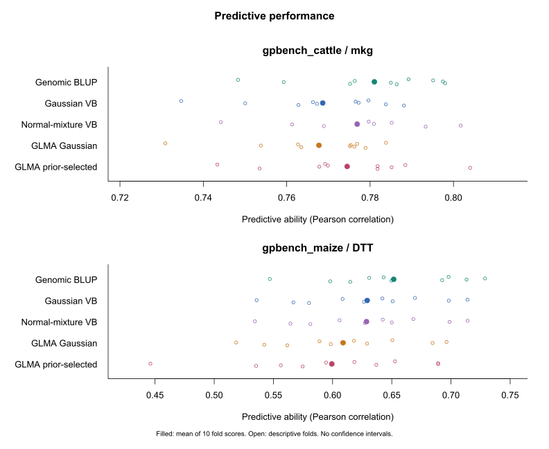
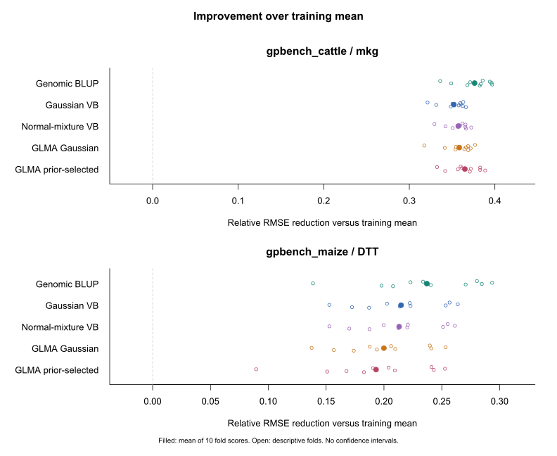
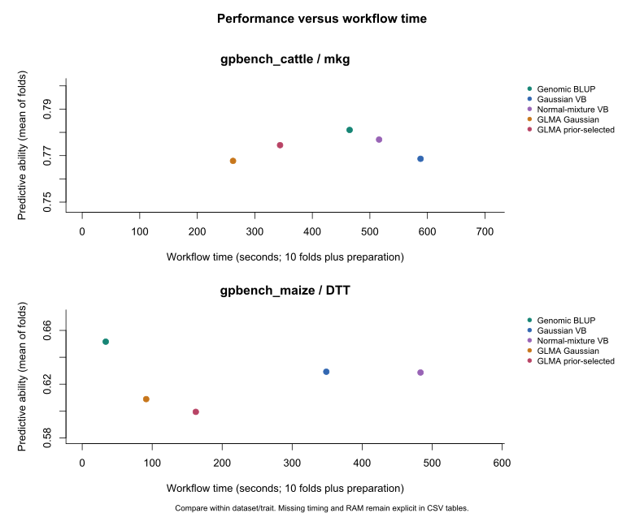
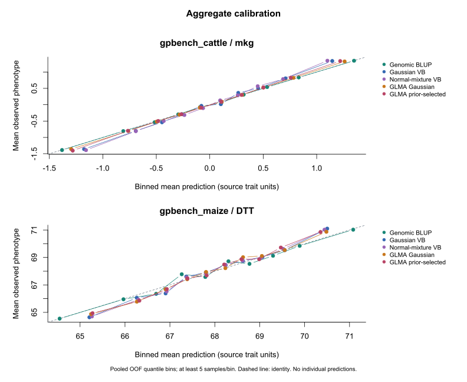

# Results and timings

> **Gaussian numerical audit warning:** GLMA’s fast path kept its starting variance because the search found no solution and failed real-data fixed-variance accuracy checks. Its scores are diagnostic, not a qualified equivalent Gaussian fit. Prior-selected shares the variance path and remains unqualified. [Audit and controlled comparisons](glma-gaussian-audit.html).

Cattle/mkg and maize/DTT compare five gsuite ecosystem models on the same saved ten-fold GPBench partitions (shuffle enabled, seed 42). The new GLMA fits use verified native MKL. Earlier greml/gsolve and gbayes measurements are retained, with their execution identities and backend differences explicit.

## What was compared?

All methods receive the same 42,551 cattle or 75,304 maize dosage columns. Genomic BLUP estimates variance by REML through greml/gsolve. gbayes Gaussian and normal-mixture VB use declared fixed training-only priors. GLMA Gaussian and GLMA prior-selected are the **full-marker prediction fits underlying glma_infinitesimal_loco() and glma_prior_selected_loco()**. They run without chromosome exclusions or association scans; no marker map is invented.

GLMA retains its native empirical marker SD scaling, constant-training-marker exclusion, blocked RHE/Monte Carlo variance refinement and internal training-fold validation. Prior-selected considers ten ridge/elastic candidates; Gaussian uses ridge. No outer test outcomes enter variance fitting or selection beyond the explicitly reproduced GPBench phenotype-imputation rule. These model/preprocessing differences mean workflow timings do not isolate solver speed.

[Dataset catalogue](assets/reports/20261121-glma-mkl/dataset_catalogue.csv)
 ·
[Exact method settings](assets/reports/20261121-glma-mkl/method_settings.csv)
 ·
[Per-fold GLMA selected priors and acceptance](assets/reports/20261121-glma-mkl/glma_fit_diagnostics.csv)

## How well did it work?

| Dataset | Model | Correlation | RMSE | Predictive R Squared | Calibration Slope | Status | Details |
| --- | --- | --- | --- | --- | --- | --- | --- |
| Cattle / mkg | Genomic BLUP | 0.7810 | 0.6235 | 0.6081 | 1.0000 | 10/10 converged | [Cattle](reports/cattle.html) |
| Cattle / mkg | Gaussian VB | 0.7686 | 0.6478 | 0.5774 | 1.1560 | 10/10 converged | [Cattle](reports/cattle.html) |
| Cattle / mkg | Normal-mixture VB | 0.7769 | 0.6427 | 0.5841 | 1.2003 | 10/10 converged | [Cattle](reports/cattle.html) |
| Cattle / mkg | GLMA Gaussian | 0.7677 | 0.6415 | 0.5855 | 1.0459 | 10/10 accepted | [Cattle](reports/cattle.html) |
| Cattle / mkg | GLMA prior-selected | 0.7745 | 0.6350 | 0.5940 | 1.0803 | 10/10 accepted | [Cattle](reports/cattle.html) |
| Maize / DTT | Genomic BLUP | 0.6516 | 2.1753 | 0.4132 | 1.0001 | 10/10 converged | [Maize](reports/maize.html) |
| Maize / DTT | Gaussian VB | 0.6292 | 2.2410 | 0.3793 | 1.1770 | 10/10 converged | [Maize](reports/maize.html) |
| Maize / DTT | Normal-mixture VB | 0.6287 | 2.2459 | 0.3767 | 1.2014 | 10/10 converged | [Maize](reports/maize.html) |
| Maize / DTT | GLMA Gaussian | 0.6088 | 2.2833 | 0.3556 | 1.1503 | 10/10 accepted | [Maize](reports/maize.html) |
| Maize / DTT | GLMA prior-selected | 0.5993 | 2.3014 | 0.3438 | 1.1742 | 10/10 accepted | [Maize](reports/maize.html) |

[Full benchmark results CSV](assets/reports/20261121-glma-mkl/benchmark_results.csv)
 ·
[Fold scores](assets/reports/20261121-glma-mkl/fold_results.csv)
 ·
[Pooled OOF scores](assets/reports/20261121-glma-mkl/pooled_results.csv)
 ·
[Observed-target-only sensitivity](assets/reports/20261121-glma-mkl/observed_only_metrics.csv)

Main scores are arithmetic means of ten test-fold metrics, matching GPBench. Predictive R² is not squared correlation. Fold variation is descriptive; folds are not independent experimental replicates and no confidence intervals are implied. Compare RMSE within each dataset/trait. Two maize DTT targets are whole-dataset mean-imputed, matching the source scheme, and explicitly flagged; observed-target-only sensitivity excludes them from scoring.

## What did it cost?

| Dataset | Model | Preparation Seconds | Fit Seconds | Prediction Seconds | Workflow Seconds | Peak RAM |
| --- | --- | --- | --- | --- | --- | --- |
| Cattle / mkg | Genomic BLUP | 11.65 | 453.07 | 0.05 | 464.77 | Not measured |
| Cattle / mkg | Gaussian VB | 5.39 | 581.28 | 1.39 | 588.06 | Not measured |
| Cattle / mkg | Normal-mixture VB | 5.22 | 509.51 | 1.29 | 516.02 | Not measured |
| Cattle / mkg | GLMA Gaussian | 3.90 | 257.79 | 0.45 | 262.14 | Not measured |
| Cattle / mkg | GLMA prior-selected | 3.78 | 339.69 | 0.43 | 343.90 | Not measured |
| Maize / DTT | Genomic BLUP | 1.81 | 31.80 | 0.02 | 33.63 | Not measured |
| Maize / DTT | Gaussian VB | 2.44 | 345.69 | 0.67 | 348.80 | Not measured |
| Maize / DTT | Normal-mixture VB | 2.53 | 480.16 | 0.75 | 483.44 | Not measured |
| Maize / DTT | GLMA Gaussian | 1.75 | 89.48 | 0.20 | 91.43 | Not measured |
| Maize / DTT | GLMA prior-selected | 1.69 | 160.41 | 0.22 | 162.32 | Not measured |

Workflow time sums preparation, fitting and held-out prediction over ten folds. greml/gsolve includes its reusable raw-dosage kernel. GLMA includes a dosage-only cache, target extraction, native packing of training rows, variance refinement, candidate selection and global refitting. Both GLMA methods are charged the full reusable cache cost once. These are single sequential executions on an Intel Core Ultra 7 258V, 8 logical processors and 32 GiB RAM; peak RAM is unmeasured.

greml/gsolve uses MKL/CHOLMOD and reports one component-backend worker. GLMA uses the full MKL native prefix with four coordinate/MKL workers; actual DGEMM dispatch was verified separately. The earlier standalone gbayes core is portable, without MKL dense kernels, and reports one worker. R OpenBLAS uses four threads, but does not automatically accelerate that portable C++ core. Backend and acceptance-rule differences must accompany any speed comparison.

[Run identities, hardware and BLAS](assets/reports/20261121-glma-mkl/run_metadata.csv)
 ·
[Checks establishing shared inputs and folds](assets/reports/20261121-glma-mkl/identity_checks.csv)
 ·
[Native binary hashes](assets/reports/20261121-glma-mkl/native_runtime_checksums.csv)

## Does the R interface slow down GLMA?

A separate fold-one repeat traces the Rcpp .Call boundary and is excluded from benchmark costs. It distinguishes the complete native call from the inner fitter: C++ genotype packing, setup and conversion sit outside the inner fitter timer. The outside-native R wrapper cost is reported at the elapsed timer resolution; loading, saving and held-out prediction are separate.

All four repeats recorded **0.00 seconds outside the native call**, at roughly 0.01-second timer resolution. Native preparation and conversion accounted for 2.45–4.04 seconds per fit. These checks do not identify the R wrapper as a meaningful fitting bottleneck.

[R/native boundary timing check](assets/reports/20261121-glma-mkl/glma_interface_cost.csv)

## Performance, cost and calibration plots

<figure class="report-figure"></figure>

[Open full-size performance SVG](assets/reports/20261121-glma-mkl/performance.svg)

<figure class="report-figure"></figure>

[Open full-size improvement SVG](assets/reports/20261121-glma-mkl/improvement.svg)

<figure class="report-figure"></figure>

[Open full-size runtime SVG](assets/reports/20261121-glma-mkl/runtime.svg)

<figure class="report-figure"></figure>

[Open full-size calibration SVG](assets/reports/20261121-glma-mkl/calibration.svg)

The improvement reference predicts the training-fold mean. Calibration publishes reviewed aggregate quantile bins with at least five individuals; individual predictions remain local.

## Source, verification and reproduction

GLMA acceptance is its native approximate joint-workflow rule, including prediction stability and adaptive chunk retirement. It is not exact REML or a strict global ELBO certificate. All failures and provisional statuses remain explicit. Earlier greml convergence sensitivity and separate fixed-variance gsolve numerical checks are retained. The external GPBench fitter was not executed.

[Software and exact private source commits](assets/reports/20261121-glma-mkl/software_sources.csv)
 ·
[Immutable recipe commits and checksums](assets/reports/20261121-glma-mkl/recipe_checksums.csv)
 ·
[Earlier greml attempt](assets/reports/20261121-glma-mkl/earlier_attempts.csv)
 ·
[greml tolerance sensitivity](assets/reports/20261121-glma-mkl/tolerance_comparison.csv)
 ·
[Separate gsolve checks](assets/reports/20261121-glma-mkl/solver_checks.csv)
 ·
[Published GPBench reference](assets/reports/20261121-glma-mkl/reference_comparison.csv)

Use the [benchmark recipes](benchmarks.html), [interfaces](methods.html), [protocol](protocol.html) and [pinned environment](https://github.com/psoerensen/gpct/tree/main/environment). Select just the added fits with GPCT_METHODS=glma_infinitesimal,glma_prior_selected. Private source checkpoints and the explicit MKL build recipe are pinned; no private implementation source or binaries enter gpct.

[Verification record](verification.html). Individual data, predictions, folds, effects and raw diagnostics remain private.
