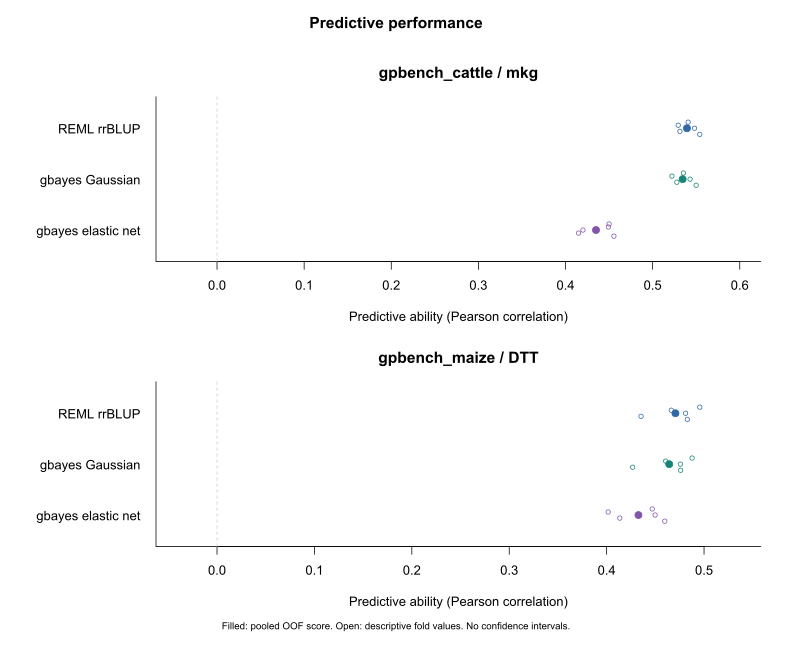
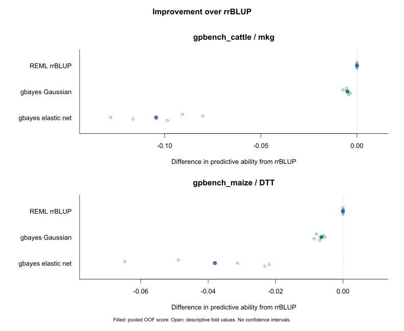
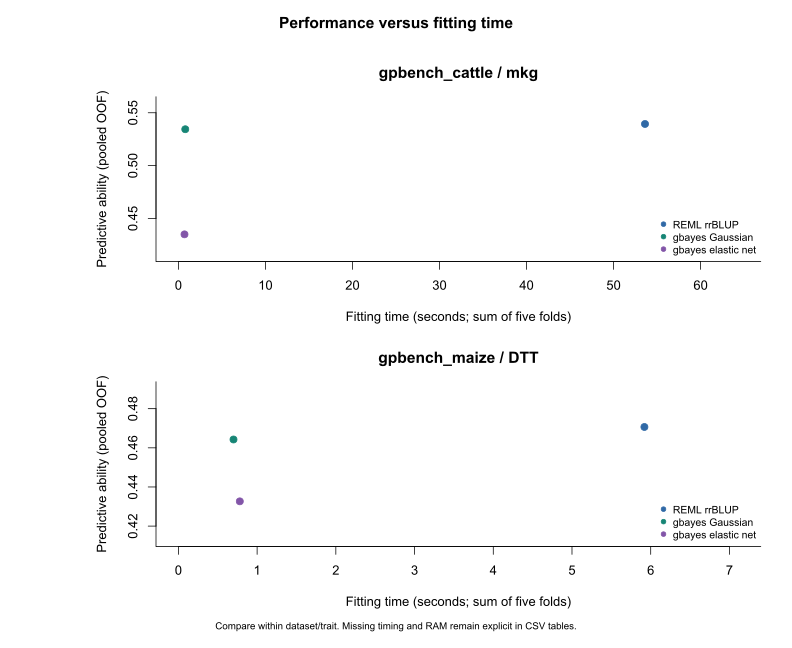
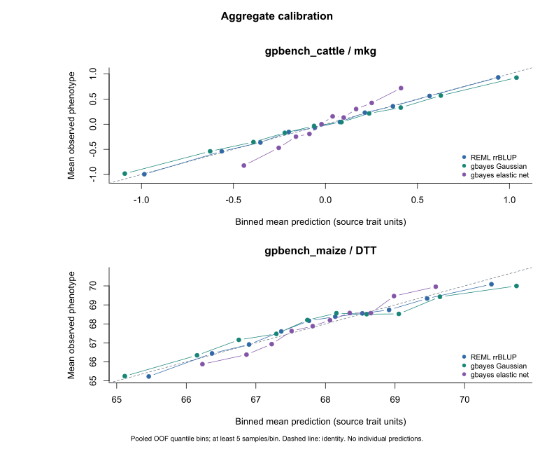

# Benchmark comparisons

**Real cattle and maize pilots completed on 2026-11-21.** All three methods
completed all five folds in both cases, with no warnings or failed fits.
Both gbayes methods reported convergence; rrBLUP exposes no convergence flag.

Each comparison asks: **What was compared? How well did it work? What did it cost?**
Detailed reports: [cattle/mkg](reports/cattle.html) and [maize/DTT](reports/maize.html).

## What was compared?

### Dataset catalogue

| Species | Dataset / target | Phenotype definition | Available / eligible individuals | Available markers | Markers used |
| --- | --- | --- | --- | --- | --- |
| Cattle | GPBench / mkg | Supplied numeric mkg; original definition, adjustments and units unverified | 5,024 / 5,024 | 42,551 | 512 in every fold |
| Maize | GPBench / DTT | Supplied numeric DTT; original definition, adjustments and units unverified | 1,458 / 1,456 | 75,304 | 512 in every fold |

Source: [GPBench](https://huggingface.co/datasets/xw97/GPBench), pinned revision
`f0204d8372fb5ec8fa29eb3f00c9a9d0a7656517`.
**Available markers and markers used are separate.** These pilots select 512
evenly spaced source columns; they do not establish whole-genome rankings.
Original sample IDs and genomic annotations are absent. Positional alignment
is explicitly acknowledged; upstream processing is unverified.

[Dataset catalogue CSV](assets/reports/20261121-openblas/dataset_catalogue.csv)

### Method settings

| Method | Package / version | Model settings | Tuning strategy | Convergence criteria |
| --- | --- | --- | --- | --- |
| REML rrBLUP | rrBLUP 4.6.3 | Training-only REML ridge; variance-ratio bounds 1e-9 to 1e9 | Variance components estimated within training folds | No flag exposed by mixed.solve |
| Fixed Gaussian | gbayes 0.1.16 | Standardized response and markers; residual variance 0.5; prior variance 0.5/p; PCG | Fixed predeclared settings | Tolerance 1e-8, cap 2,000 iterations; converged in every fold |
| Elastic net | gbayes 0.1.16 | Standardized response and markers; lambda 0.1; alpha 0.5; coordinate descent | Fixed predeclared settings | Tolerance 1e-8, cap 2,000 iterations; converged in every fold |

Single random five-fold partition, seed 4401, shared across methods. All
imputation, scaling and response transformations use training samples only.
No test-fold tuning. [Method settings CSV](assets/reports/20261121-openblas/method_settings.csv).

## How well did it work, and what did it cost?

Main metrics below use **pooled out-of-fold predictions**. Fit and prediction
times are summed over five folds, in elapsed seconds. RAM was not measured.

| Dataset / trait | Method | Predictive ability | RMSE | Predictive R² | Calibration slope | Fit (s) | Predict (s) | Peak RAM | Status | Recipe | Report |
| --- | --- | --- | --- | --- | --- | --- | --- | --- | --- | --- | --- |
| Cattle / mkg | REML rrBLUP | 0.5394 | 0.8420 | 0.2916 | 0.9893 | 53.61 | 0.02 | Not measured | 5/5 completed | [Recipe](https://github.com/psoerensen/gpct/tree/main/benchmarks/cattle_prediction) | [Report](reports/cattle.html) |
| Cattle / mkg | Fixed Gaussian | 0.5344 | 0.8480 | 0.2814 | 0.8844 | 0.79 | 0.03 | Not measured | 5/5 completed | [Recipe](https://github.com/psoerensen/gpct/tree/main/benchmarks/cattle_prediction) | [Report](reports/cattle.html) |
| Cattle / mkg | Elastic net | 0.4350 | 0.9206 | 0.1532 | 1.7906 | 0.70 | 0.02 | Not measured | 5/5 completed | [Recipe](https://github.com/psoerensen/gpct/tree/main/benchmarks/cattle_prediction) | [Report](reports/cattle.html) |
| Maize / DTT | REML rrBLUP | 0.4706 | 2.5280 | 0.2215 | 0.9427 | 5.92 | <0.01 | Not measured | 5/5 completed | [Recipe](https://github.com/psoerensen/gpct/tree/main/benchmarks/maize_prediction) | [Report](reports/maize.html) |
| Maize / DTT | Fixed Gaussian | 0.4643 | 2.5538 | 0.2055 | 0.8170 | 0.70 | 0.01 | Not measured | 5/5 completed | [Recipe](https://github.com/psoerensen/gpct/tree/main/benchmarks/maize_prediction) | [Report](reports/maize.html) |
| Maize / DTT | Elastic net | 0.4327 | 2.5946 | 0.1799 | 1.2637 | 0.78 | <0.01 | Not measured | 5/5 completed | [Recipe](https://github.com/psoerensen/gpct/tree/main/benchmarks/maize_prediction) | [Report](reports/maize.html) |

[Results CSV](assets/reports/20261121-openblas/benchmark_results.csv) ·
[Per-fold values](assets/reports/20261121-openblas/fold_results.csv) ·
[Descriptive fold means](assets/reports/20261121-openblas/fold_metric_means.csv)

rrBLUP had the highest pooled predictive ability in each pilot. Fixed Gaussian
was close, while elastic net performed less well at its predeclared settings.
Calibration slopes above one for elastic net indicate predictions with too
little spread. These results do not establish superiority across datasets or
settings, and the fixed settings were not tuned to improve these results.

R 4.4.3, gbase 0.1.14, OpenBLAS 0.3.29 with four runtime threads; Intel Core Ultra
7 258V, 8 logical processors, 32 GiB RAM. gbayes requests one package worker.
The BLAS thread setting is recorded separately from observed CPU utilization,
which was not measured. See [run metadata](assets/reports/20261121-openblas/run_metadata.csv)
and the [rebuild recipe](https://github.com/psoerensen/gpct/tree/main/environment).

These are single-execution timings without repeats or confidence intervals.
rrBLUP estimates variance components, whereas the other methods use fixed
settings; timing differences include different fitting tasks. Measured zero
prediction times in the CSV are below the timer's resolution, shown as <0.01 s
here. Total case execution was 58.64 s for cattle and 8.69 s for maize, including
all methods and shared work. Peak RAM remains NA, never zero.

### Predictive performance

<figure class="report-figure"></figure>

[Full-size performance SVG](assets/reports/20261121-openblas/performance.svg)

### Improvement over rrBLUP

<figure class="report-figure"></figure>

[Full-size improvement SVG](assets/reports/20261121-openblas/improvement.svg)

### Performance versus fitting time

<figure class="report-figure"></figure>

[Full-size runtime SVG](assets/reports/20261121-openblas/runtime.svg)

### Aggregate calibration

<figure class="report-figure"></figure>

[Full-size calibration SVG](assets/reports/20261121-openblas/calibration.svg) ·
[Aggregate bins CSV](assets/reports/20261121-openblas/calibration_bins.csv)

Only aggregate bin means and counts are public. Individual out-of-fold
predictions and fold membership stay local. Bins contain at least 145 maize
or 502 cattle observations. The plots do not recalibrate predictions.

## Interpretation and reproduction

- Compare methods within a dataset–trait pair; raw RMSE across traits has different units.
- Pooled OOF scores differ from arithmetic means of fold metrics; both are downloadable.
- Open fold dots show descriptive variation. Folds are not independent experimental replicates; no confidence intervals are implied.
- Random splits test within-cohort prediction, not transfer across herds, families, environments or time.
- Missing RAM and observed thread utilization remain explicit. Failed fits must remain visible in future runs.

See the [detailed cattle report](reports/cattle.html), [detailed maize report](reports/maize.html),
[evaluation definitions](protocol.html), [reproduction commands](benchmarks.html)
and [verification record](verification.html).
[Blank table and plot templates](assets/reports/templates/report.html) remain available for new cases.
Association and genetic-correlation benchmarks need their own outcomes and reporting schemas.
